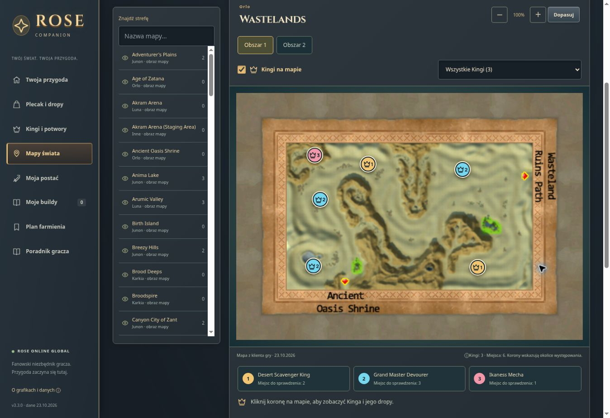

# Publikacja ROSE Companion w GitHub Pages

Data weryfikacji: 23.10.2026.

- Publiczna strona: https://abeel87.github.io/rose-builds/
- Sprawdzony widok: https://abeel87.github.io/rose-builds/#/map?zone=Wastelands
- Commit aplikacji i konfiguracji publikacji: `e0c9a1ee7b3206b6ffc65e3afa7e231f2df4d824`.
- Wdrożenie: https://github.com/Abeel87/rose-builds/actions/runs/39978074018 — build i deploy zakończone powodzeniem.
- Walidacja plików statycznych, 229 zasobów offline i 44 testy zakończone powodzeniem.
- Przeglądarka potwierdziła otwarcie aplikacji 3.3.0 na nowej domenie oraz sześć koron Kingów w Wastelands, Obszar 1.
- W sprawdzonej lokalnej kopii tego samego kodu przejście korona → wygląd i dropy → powrót zachowało zaznaczony punkt.

## Podgląd publicznej strony

## Zakres

Atlas zawiera 77 stref i 81 widoków. Dane obejmują 427 miejsc dla 81 spośród 95 bossów; 14 wpisów nie ma potwierdzonych dokładnych punktów. Korony pokazują możliwe miejsca pojawienia się przeciwnika z danych klienta, a nie jego bieżącą obecność na serwerze.

Pamięć przeglądarki jest oddzielna dla każdej domeny. Wcześniejsza publikacja Sites pozostała dostępna, a zapisane buildy można przenieść eksportem/importem JSON. Nie zmieniono jej ustawień dostępu ani nie usunięto starych zapisów.
